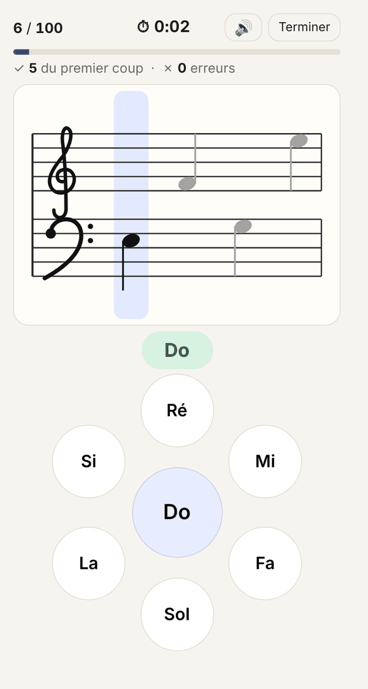
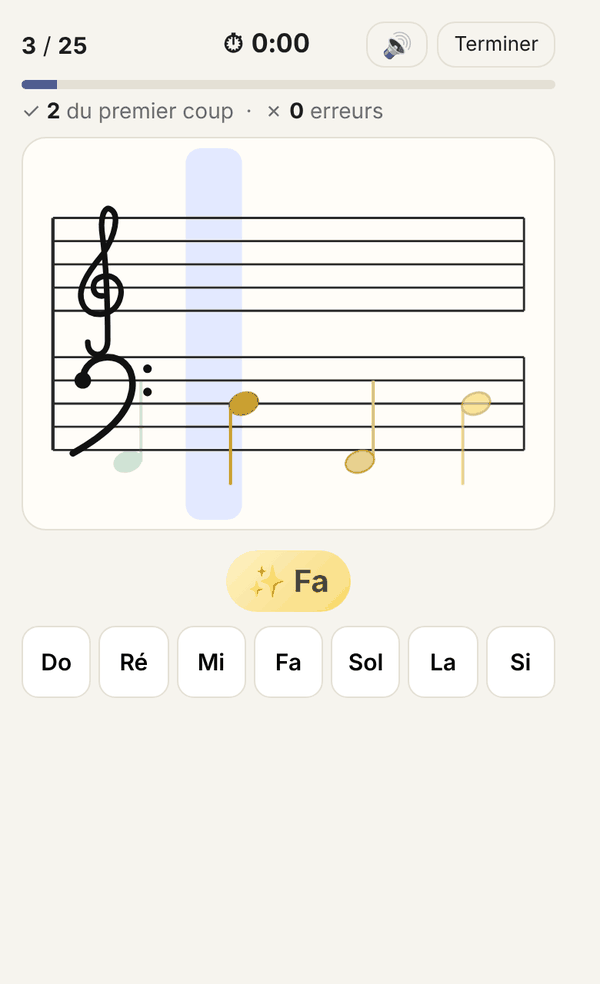
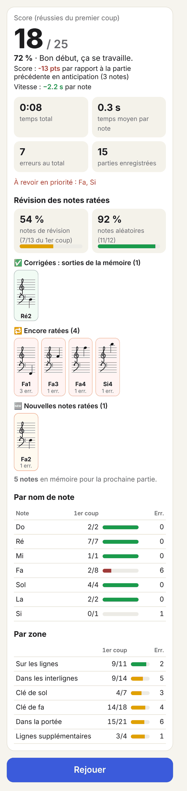
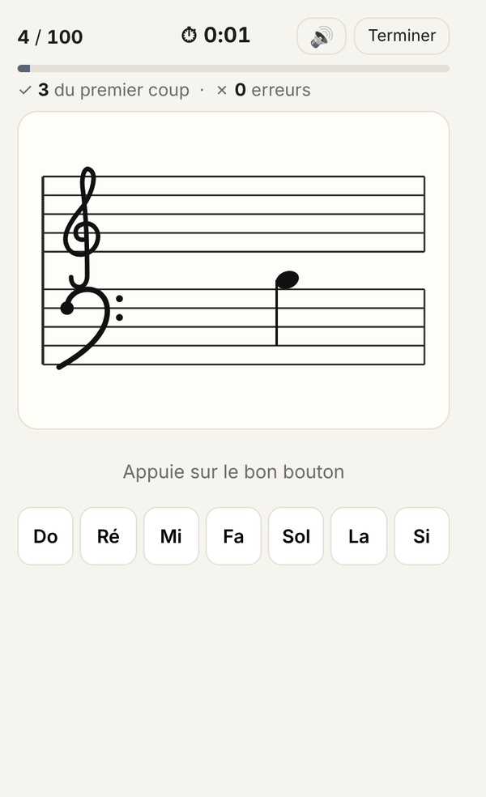
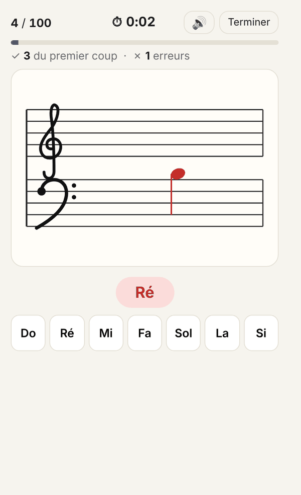
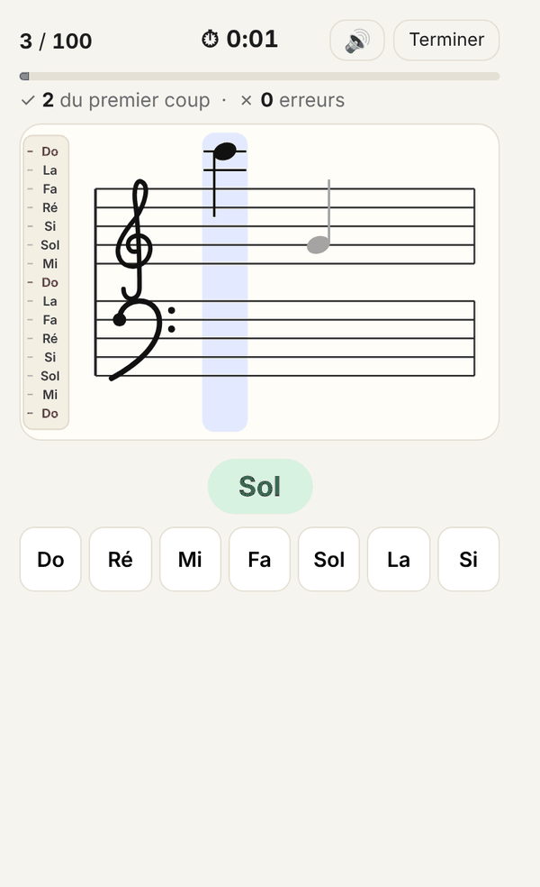
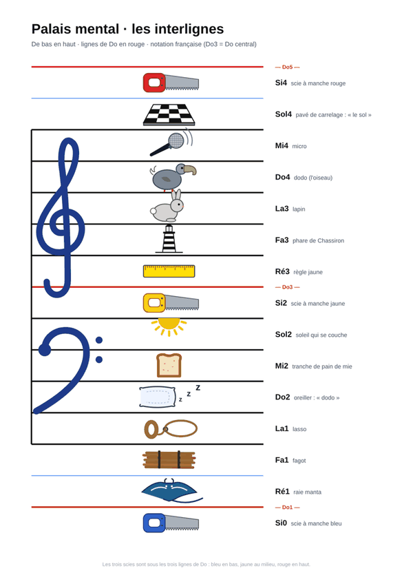
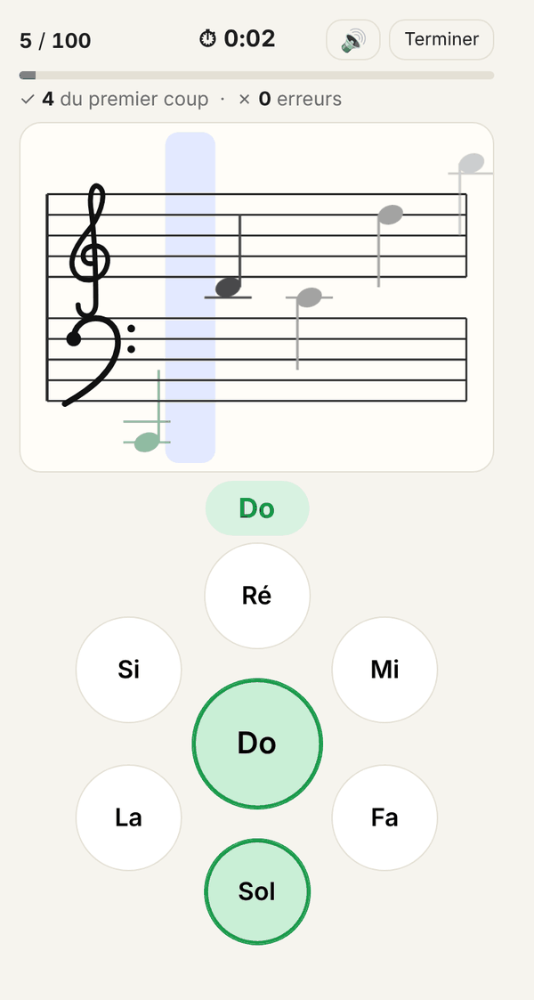
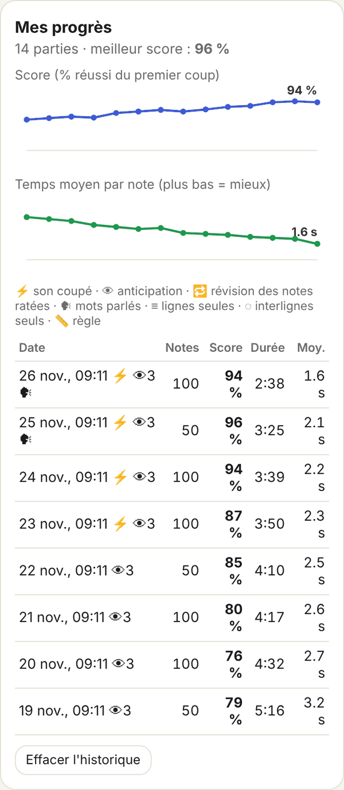
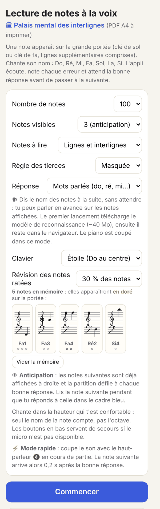

# 🎼 Solfège : lis tes notes, vite et sans galérer

**Tu galères avec la lecture de notes ? Cette appli est faite pour toi.**

Que tu débutes et confondes encore le Fa et le La en clé de fa, ou que tu lises déjà bien et que tu veuilles **lire plus vite et anticiper** comme un vrai déchiffreur, cette petite appli t'entraîne en quelques minutes par jour, directement sur ton téléphone.

👉 **[Essayer maintenant](https://fabrice-mougin.github.io/solfege/)**, rien à installer, rien à créer, ça marche dans le navigateur.

<p align="center">
  
  &nbsp;
  
  &nbsp;
  
</p>

---

## Pourquoi cette appli ?

- **Sur la grande portée, comme au piano** : clé de sol et clé de fa, avec les lignes supplémentaires au-dessus, au-dessous et autour du Do central (du Do1 au Do5).
- **Tu réponds comme tu veux** : avec des boutons, en **chantant** la note, ou simplement en **disant son nom** (« do, ré, mi… »).
- **Elle s'adapte à ton niveau** : règle d'aide pour débuter, lignes ou interlignes seulement, puis anticipation jusqu'à 4 notes à l'avance pour les plus rapides.
- **Elle retient tes erreurs** et te les repropose à la partie suivante, jusqu'à ce qu'elles soient corrigées.
- **Tu vois tes progrès** : score, temps par note, courbes et historique.
- **Tout reste chez toi** : un seul fichier, aucun compte, aucune donnée envoyée sur Internet (même la reconnaissance vocale tourne dans ton navigateur).

---

## 🌱 Pour les débutants

### Une note, un bouton

Une note apparaît, tu donnes son nom. En cas d'erreur, la note passe en rouge et l'appli attend la bonne réponse. À chaque bonne réponse, **la vraie note de piano** est jouée à sa hauteur exacte : ton oreille apprend en même temps que tes yeux.

<p align="center">
  
  &nbsp;&nbsp;
  
</p>

### La règle des tierces et le travail ciblé

- **Règle des tierces** (à gauche ou à droite) : elle rappelle la chaîne **do mi sol si ré fa la do**, posée sur les lignes, avec les Do en rouge. C'est l'astuce qui fait tout : chaque ligne est une tierce au-dessus de la précédente. Sur les interlignes, la chaîne continue de la même façon.
- **Notes à lire** : *lignes et interlignes*, *lignes seulement* ou *interlignes seulement*, pour travailler un point faible à la fois.

<p align="center">
  
</p>

### Le palais mental des interlignes

Un moyen mnémotechnique à imprimer : chaque interligne a sa figurine (une raie manta pour le Ré, un fagot pour le Fa, un lasso pour le La, un dodo pour le Do…). Le lien est sur l'écran d'accueil : **[palais-mental-A4.pdf](palais-mental-A4.pdf)**.

<p align="center">
  
</p>

---

## 🚀 Pour aller plus vite

### L'anticipation : lire la note suivante pendant que tu joues la note courante

Choisis **2, 3 ou 4 notes visibles** : la note à jouer est dans le cadre bleu (en noir), les suivantes attendent en gris à droite. À chaque bonne réponse, la partition défile **sans aucune attente** : tu peux enchaîner aussi vite que tu lis.

### Le clavier en étoile

Le **Do au centre**, les autres notes en cercle autour (Ré en haut, puis Mi, Fa, Sol, La, Si). Plus besoin de traverser l'écran pour passer du Si au Do : chaque note est à un pas du centre et chaque direction devient un réflexe.

### Les mots parlés : la méthode la plus rapide

Dis simplement le nom des notes, à la suite, sans attendre : « si… sol… fa… si… ». Tu peux parler **en avance** sur les notes affichées : les mots entrent dans une file et sont traités dans l'ordre. La touche correspondante clignote en vert (ou en rouge) pour que tu voies ce qui a été compris sans quitter la partition des yeux.

- Un mot **faux** compte une erreur, puis l'appli attend un court silence pour que tu reprennes sur la bonne note.
- Un mot **non compris** ne compte pas comme une erreur : un petit son « hein ? » te le signale.
- La reconnaissance (modèle français Vosk, ~40 Mo téléchargés une seule fois) **tourne entièrement dans ton navigateur**.

<p align="center">
  
  &nbsp;&nbsp;
  
</p>

### Le mode rapide ⚡

Coupe le son avec le haut-parleur 🔇 : la note suivante arrive alors 0,2 s après la bonne réponse. Pour ceux qui chassent les secondes.

---

## 🔁 Tes erreurs reviennent… jusqu'à ce que tu les corriges

Chaque note ratée est mémorisée à sa position exacte sur la portée. Avec l'option **Révision des notes ratées** (10 à 50 % de la partie), elles reviennent **en doré** sur la partition. Trouve-la du premier coup et une petite clochette ✨ te le dit : la note sort de la mémoire.

<p align="center">
  
</p>

---

## 📊 Tes progrès, partie après partie

À la fin de chaque partie : score du premier coup, temps total et temps moyen par note, erreurs par nom de note, par clé, lignes et interlignes, notes corrigées et notes encore ratées. Tu es aussi comparé à **ta partie précédente jouée dans le même mode**, pour des progrès qui veulent dire quelque chose.

L'écran d'accueil garde l'historique avec deux courbes : ton score qui monte et ton temps par note qui descend.

<p align="center">
  
  &nbsp;&nbsp;
  
</p>

---

## ⚙️ Tous les réglages

<p align="center">
  
</p>

| Réglage | Choix |
|---|---|
| Nombre de notes | 10, 25, 50 ou 100 |
| Notes visibles | 1 (classique) à 4 (anticipation) |
| Notes à lire | lignes et interlignes, lignes seulement, interlignes seulement |
| Règle des tierces | masquée, à gauche, à droite |
| Réponse | boutons seulement, voix chantée (hauteur), mots parlés |
| Clavier | ligne (Do à Si) ou étoile (Do au centre) |
| Révision des notes ratées | désactivée, 10, 20, 30 ou 50 % |
| Son | 🔊 piano, ou 🔇 mode rapide |

Tous les réglages sont mémorisés. L'écran reste allumé pendant une partie.

---

## 📱 Utilisation

Le plus simple : ouvre **https://fabrice-mougin.github.io/solfege/** sur ton téléphone. Pour l'avoir comme une appli, utilise « Ajouter à l'écran d'accueil » dans le menu du navigateur.

Le micro (voix chantée et mots parlés) ne fonctionne que sur une page en **https** ou en **localhost** : c'est le cas sur GitHub Pages.

### En local

```bash
git clone https://github.com/fabrice-mougin/solfege.git
cd solfege
python3 -m http.server 8000
```

Puis ouvre **http://localhost:8000/** (et pas `0.0.0.0`, sinon le navigateur bloque le micro). Ouvrir le fichier directement en `file://` fonctionne pour les boutons, mais pas pour les mots parlés.

### Fichiers

| Fichier | Rôle |
|---|---|
| `index.html` / `solfege.html` | l'appli complète, en un seul fichier (sons de piano inclus) |
| `model.tar.gz` | modèle de reconnaissance vocale français, chargé seulement en mode « mots parlés » |
| `palais-mental-A4.pdf` | le palais mental des interlignes, à imprimer |
| `docs/screenshots/` | les captures de ce README |

---

## 📜 Licence : libre, pour partager

Ce projet est un **logiciel libre** : tu peux l'utiliser, le copier, le modifier et le republier, y compris pour enseigner ou dans une école de musique.

- **Le code** est sous licence **[GNU GPL v3 ou ultérieure](LICENSE)**. Si tu publies une version modifiée, elle doit rester libre sous la même licence : les améliorations profitent ainsi à tout le monde.
- **Le palais mental, les captures et la documentation** sont sous licence **[CC BY-SA 4.0](LICENSES/CC-BY-SA-4.0.txt)** : partage et adaptation autorisés, en citant le projet et en gardant la même licence.

Les contributions sont les bienvenues : ouvre une *issue* pour une idée ou un bug, ou une *pull request* pour proposer une amélioration.

## 🙏 Crédits

- **Sons de piano** : [Salamander Grand Piano](https://github.com/sfzinstruments/SalamanderGrandPiano) (Yamaha C5), par Alexander Holm, licence **CC BY 3.0**.
- **Reconnaissance vocale** : [Vosk](https://alphacephei.com/vosk/) (Alpha Cephei) via [vosk-browser](https://github.com/ccoreilly/vosk-browser) (Apache 2.0), modèle `vosk-model-small-fr-0.22`.

Le détail des licences des éléments de tiers est dans [`NOTICE.md`](NOTICE.md).

Les scores et l'historique restent dans ton navigateur : rien n'est envoyé nulle part.
